<p align="center">
  
</p>
<h1 align="center">Godotwright</h1>
<p align="center"><b>MCP server and CLI that makes Claude Code, Codex and any coding agent better at Godot 4.</b><br>
Offline Godot 4.7 API, a project map, headless checks and an AAA review of GDScript.</p>
<p align="center">
  <a href="https://github.com/laaielichter/Godotwright/actions/workflows/ci.yml"></a>
  <a href="LICENSE"></a>
  
  
  <a href="https://www.npmjs.com/package/godotwright"></a>
</p>
<p align="center">
  <a href="https://laaielichter.github.io/Godotwright/">Website</a> ·
  <a href="#quickstart">Quickstart</a> ·
  <a href="#use-with-claude-code-codex-and-other-coding-agents-mcp">MCP setup</a> ·
  <a href="bench/RESULTS.md">Benchmark</a> ·
  <a href="ROADMAP.md">Roadmap</a>
</p>
<p align="center">
  
</p>

Coding agents learned Godot from years of Godot 3 tutorials. They write `yield`,
`export var` and `KinematicBody2D`, invent methods, and wire signals to nodes that
are not in the scene. Godotwright gives the agent the real Godot 4.7 API, a compact
map of your project, real Godot checks and a fixed AAA review, as MCP tools and as a CLI.

> Status: layer 1 (toolkit and MCP server) is done; see [ROADMAP.md](ROADMAP.md).

## Quickstart

```sh
npx -y godotwright review ~/games/my-game
```

You get a score from 0 to 100 for api, performance, quality and structure, and each
finding as `res://file.gd:12: error [rule] message` with the Godot 4 fix.
Then [connect it to your agent](#use-with-claude-code-codex-and-other-coding-agents-mcp).

## Why Godotwright?

- **No more Godot 3 code.** The review flags Godot 3 syntax and names and gives the Godot 4 replacement.
- **No invented API.** Every class, method, property and signal is checked against the
  official Godot 4.7 class reference, bundled offline (1078 classes).
- **Mistakes found before you press F5.** Missing `$Node` paths, scene connections to
  methods that do not exist, unknown input actions and broken `preload()` paths.
- **Cheap for the model.** Compact, stable output, and a `cheap` profile that walks
  small models through small checked steps.
- **Local and private.** `scan`, `api` and `review` need no Godot install and no network.

## Commands

```sh
godotwright scan [path]               # compact project map, cheap to read
godotwright scan [path] --detail full # node trees, signatures, line numbers
godotwright scan [path] --json        # the full map as JSON
godotwright check [path]              # run Godot headless, report errors as file:line
godotwright check [path] --run        # also run the main scene for 120 frames
godotwright api Node2D.look_at        # offline Godot 4.7 API: classes, methods, signals
godotwright api --search "is on floor"
godotwright review [path]             # AAA review with a score per category
godotwright review [path] --detail full --min-score 90
godotwright model car.glb             # what is in a 3D model: nodes, triangles, textures, size
godotwright model lint car.glb        # model review with a score per category
godotwright model contract car.glb    # write a model.contract.json: node names, size, budget
godotwright model lint car.glb --archetype car   # also check it is what it should be
godotwright model lint car.glb --contract model.contract.json
godotwright model identify "a tractor" # what it is: parts, size, variants, what to anticipate
godotwright model archetypes          # the family tree of things Godotwright knows
godotwright model kinds               # what `model build` can make, with parameters
godotwright model build house -o house.glb --set floors=3 --set roof=hip
godotwright learn                     # what Godotwright learned on this machine
```

`scan` reads `project.godot`, scenes, resources and scripts without starting Godot.
It lists scenes with their node trees, scripts with signals, functions and exports,
autoloads, input actions and key settings, and warns about broken references
(missing files, a missing main scene or autoload, bad `preload()` paths).

`check` needs Godot 4.7: `--godot <path>`, `$GODOT`, `godot` on your PATH, or a Godot 4 download
it finds by itself (Program Files, Steam, Scoop, Downloads, Desktop). It imports
the project, loads and instantiates every script and scene, and can run the main scene.
Each problem comes back once, as `res://path/file.gd:12: error: ...`.
The exit code is 1 when there are errors.

`api` answers from the official Godot 4.7 class reference, bundled offline
(1078 classes). It accepts `Class`, `Class.member`, `Class.Enum.VALUE`, `@annotation`
or a global function, follows inheritance, and explains Godot 3 names
(`KinematicBody2D` is `CharacterBody2D` in Godot 4). See [data/README.md](data/README.md).

`review` needs no Godot install. It scores four categories from 0 to 100 and lists
each finding as `res://file.gd:12: error [rule] message`:

| Category | What it checks |
| --- | --- |
| api | Godot 3 code, unknown classes, functions, members and signals, wrong argument counts, input actions missing from the Input Map |
| performance | node lookups, `load()`, prints and physics calls in per-frame callbacks, empty callbacks, shadow-casting lights |
| quality | static typing coverage, long or deeply nested functions, signals never emitted, string-based signals, naming, TODOs |
| structure | broken references, scene connections to missing methods or signals, `$Node` paths missing from the scene, unknown groups, file naming |

The checks follow Godot's own rules (inheritance, scripts on more specific nodes,
inherited scenes, built-in scripts, duck typing with `has_method()`), and are tuned
on the official demo projects so they report real problems, not noise.
The exit code is 1 when there are errors, or when the score is below `--min-score`.

`model` reads a `.glb` or `.gltf` file without Godot. `model` alone shows the node tree,
triangle count, materials, textures (with an estimate of texture memory), size and lowest
point. `model lint` scores four categories from 0 to 100:

| Category | What it checks |
| --- | --- |
| geometry | triangles facing against their own normals (pink backfaces, wrong light), open edges on single-sided surfaces, edges shared by more than two triangles, triangles without area, negative scale, models that are almost but not quite left-right symmetric |
| materials | missing normals, UVs or tangents, UVs outside 0..1, very large or non-power-of-two textures |
| performance | triangle budget (`--max-triangles`), texture memory budget (`--max-texture-mb`), many materials |
| rig | sibling nodes with the same name, unnamed nodes, a model that does not sit on y = 0, an empty file |

Findings are grouped per node, and their severity follows how much of the surface is
affected, so one stray triangle is an info and a flipped panel is an error.
A **model contract** (`model.contract.json`) pins what a model must keep, so a renamed node or a
hull that grows 3 cm wider is caught. `model contract` writes one from the model as it is now;
review it, add a `source` to each size, and keep it next to the model. With `--contract`, `model lint`
reports `contract-missing-node`, `contract-order`, `contract-extra-node`, `contract-size`,
`contract-ground` and `contract-triangles`. Sizes default to a 1% tolerance, or set `tolerance` in metres.
The exit code is 1 when there are errors, or when the score is below `--min-score`.

`model build` makes a model from code, with no Blender or other tool: a clean `.glb` with UVs and
tangents, named parts with sensible pivots, standing on y = 0, and the same bytes every time for the
same parameters. The result goes straight through `model lint`, and `--contract-out` writes a
`model.contract.json` for it. `model kinds` lists the kinds with their parameters, ranges and defaults;
set them with `--set name=value` or `--spec file.json`. These are clean, parametric base models, built
to be refined, not hand-sculpted art. Kinds today: `house`, plus recipes, which are ready-made specs in
`data/recipes/`: `car`, `tractor`, `helicopter`, `airliner`, `ship`, `tree`, `conifer`,
`wind-turbine`, `shipping-container`, `truck`, `bus`, `motorcycle`, `bicycle`, `train`, `tank`, `light-aircraft`, `fighter`, `drone`, `boat`, `sailboat`, `piston-engine`, `jet-engine`, `barn`, `tower`, `church`, `windmill`, `apartment`, `bridge`, `road`, `railway-track`, `street-lamp`, `fence`, `power-pylon`, `palm`, `bush`, `grass`, `flower`, `crate`, `barrel`, `chair` and `table`. Every recipe names its archetype, so `model build` checks
it as it builds, and every recipe is tested to stay clean at the lowest and highest value of each parameter.

`model identify` says **what a thing is** before you build it, from its name in English or Dutch (typos,
plurals and Dutch compounds like "vrachtauto" included) or from a description ("something with wheels and
an engine"). It answers with the family it belongs to, the parts a model of it needs (and which move, about
which axis, with the pivot where), a typical size range with its source and a confidence class, the variants
(a car can be a sedan, a hatchback, a pickup), the Godot conventions (+Y up, the front faces +Z), what to
anticipate (collision, LODs, lights) and the usual mistakes. A word that means two things (the Dutch
"windmolen") is reported as ambiguous, and something it does not know gets the nearest family, marked
generic, instead of a made-up answer. The library is data in `data/archetypes/` and grows with pull requests.

`model lint --archetype <what>` (or `"archetype": "vehicle.wheeled.car"` in a spec, or any built-in kind)
holds a model against what `identify` says that thing is, as a fifth category, `archetype`, worth a fifth
of the score:

| Rule | What it catches |
| --- | --- |
| `archetype/missing-part` | a car without wheels, a helicopter without a rotor (parts are recognised by node name in English or Dutch) |
| `archetype/part-count` | two wheels on a car, five on a bicycle |
| `archetype/pivot` | a wheel not turning about its hub, a door not pivoting on its hinge line, a turret not on its base |
| `archetype/wheel-axis` | a wheel lying the wrong way |
| `archetype/size` | a model about 10 times too big or small, which is nearly always a unit mistake (it only flags a difference of more than 3 times, since the ranges are typical, not exact) |
| `archetype/orientation` | a car that points sideways instead of along z |
| `archetype/optional-part` | the usual parts that are not there (info) |

Anything else is built from a **model spec**: a JSON tree of named parts (box, cylinder, ellipsoid,
lathe, loft, extrude, roof) with `at`, `rotate`, `mirror`, `repeat`, variables and arithmetic
expressions (`"$width / 2 - 0.1"`, never executed as code). `model spec` explains the format and prints a
small car as an example; `model build --spec car.json --set width=1.9` builds it. Every moving part is
its own node with its pivot at its origin (a wheel at its hub), and a spec that goes wrong gets a message
with its path (`nodes[0].children[2].size[1]: unknown variable $x`).

## Review in GitHub Actions

Save this as `.github/workflows/godot-review.yml` in your game repository. It
reviews the project on every push and pull request, failing if there are errors
or the overall score is below 80. The static review needs only Node.js 22.12+
(Node 24 below), not a Godot install, model or API key.

```yaml
name: Review Godot project
on: [push, pull_request]
permissions:
  contents: read
jobs:
  review:
    runs-on: ubuntu-latest
    steps:
      - uses: actions/checkout@v5
      - uses: actions/setup-node@v5
        with:
          node-version: 24
      - run: npx --yes github:laaielichter/godotwright#0dd9ce885df21fafefc09f8ddd6e92745d5ae303 review . --min-score 80
```

The toolkit is pinned to a revision; update that revision deliberately when you
want a newer version. For a game in a subdirectory, set `working-directory` on
the review step to the folder containing `project.godot`.

## Mods and patches over a game

A mod or patch often uses scripts, scenes and models that live in the game, not in
the mod's folder. Point Godotwright at the game so they count as present:

```sh
godotwright review mod/ --base game/                       # the game's source folder
godotwright review mod/ --base-files game/pck-manifest.json # files the shipped .pck holds
```

or put it in `godotwright.json` in the mod's root (paths relative to that root):

```json
{ "base": ["../game"], "baseFiles": ["../manifests/pck-files.json"] }
```

The game's classes, autoloads, input map and scenes are then known, the mod's own
files win where both have the same path, and only the mod's files are reviewed.
A file list is text with one path per line, or JSON (strings, or objects with a
`path`, `resource` or `file` key); exported names such as `x.glb.import` and
`x.gdc` map back to their source.

## Use with Claude Code, Codex and other coding agents (MCP)

`godotwright mcp` runs an MCP server over stdio with seven tools:

| Tool | What it does |
| --- | --- |
| `godot_scan` | Map the project: scenes and node trees, scripts, signals, autoloads, input map |
| `godot_api` | Exact Godot 4.7 lookup: signatures, inheritance, Godot 3 names |
| `godot_api_search` | Search the Godot 4.7 class reference |
| `godot_review` | AAA review with scores; also reviews unsaved code (`code` + `file`) |
| `godot_check` | Run Godot headless and report errors as file:line |
| `godot_checklist` | Every AAA rule with its fix |
| `godot_feedback` | Mark a review finding as wrong or right, so later reviews learn from it |
| `godot_model_identify` | What a thing is: parts, pivots, typical size with its source, variants, what to anticipate (English or Dutch) |
| `godot_model_spec` | The model spec format, an example and the ready-made kinds |
| `godot_model_build` | Build a clean `.glb` from a kind or a spec (written inside the project), and lint it |
| `godot_model_lint` | Score a `.glb`; with `archetype` also check it is what it should be |
| `godot_model_inspect` | What is in a `.glb`: nodes, triangles, textures, size |

Pick a profile with `--tier`:

- `cheap` (default): short output, and server instructions that walk the model
  through small checked steps (scan, look up, review before saving, review after each edit).
- `premium`: full detail, all findings with fixes.

**Claude Code**

```sh
claude mcp add godotwright -- npx -y godotwright mcp --tier premium
```

**Codex**

```sh
codex mcp add godotwright -- npx -y godotwright mcp --tier premium
```

or in `~/.codex/config.toml`:

```toml
[mcp_servers.godotwright]
command = "npx"
args = ["-y", "godotwright", "mcp", "--tier", "premium"]
startup_timeout_sec = 30 # the first npx run downloads the package
```

Run the agent from the Godot project folder (or pass `--project <path>`).
CI connects both Claude Code and Codex to the server on every push.

## Learning

Godotwright learns from every use, on your machine:

- **Rules Godot keeps contradicting.** After each `check`, it compares the review with
  what real Godot reported. When an error rule is contradicted 3 times here and never
  confirmed, its findings become warnings, marked as hints.
- **False alarms.** `godotwright learn feedback wrong "<finding line>"` (or the
  `godot_feedback` MCP tool) hides that finding in later reviews.
- **API lookups.** When a lookup finds nothing and the next one does, the next failed
  lookup of the same name says what it usually means.

Nothing leaves your machine unless you say yes. The learning file (`godotwright learn` shows where) holds
counters, rule names, API names and message templates without names or paths; findings
marked as wrong are stored as hashes.

```sh
godotwright learn          # status: what was learned, where the file is
godotwright learn off      # stop learning (or set GODOTWRIGHT_LEARN=0)
godotwright learn on
godotwright learn reset    # forget everything
godotwright learn preview  # the exact report sharing would send
godotwright learn share on # opt in: send anonymous counts once a day
```

Sharing helps every user: what many installs learn ships with later releases.
It is off by default, sends no code, file names, paths or project names, and
respects `DO_NOT_TRACK`. See [PRIVACY.md](PRIVACY.md).
Set `GODOTWRIGHT_HOME` to keep the file somewhere else.

Godotwright also learns for free from public projects: every week the Learn
workflow reviews the official Godot demos, and the same demos written for Godot 3,
checks them with real Godot, and records which rules Godot confirmed or
contradicted. That, plus what opted-in installs share, ships in `data/learned.json`:
API hints for common typos, and rules Godot keeps contradicting.
What your own machine saw wins: one confirmation by Godot keeps a rule an error.

For maintainers, `godotwright collector serve` accepts reports (checked again,
stored without IP addresses), and `godotwright collector aggregate <dir> --out
data/learned.json` sums them, keeping only what at least 3 installs reported.
`godotwright collector projects <dirs...>` learns from public projects.

## Benchmark

`bench/` runs coding agents on fixed Godot tasks with and without Godotwright, and lets
real Godot 4.7.2 judge the result with a behavior test per task.
First round (168 runs, Claude Haiku, Sonnet and Opus 5.5, 12 tasks): every run passed,
with and without Godotwright, so these tasks do not separate the setups on correctness.
With Godotwright, all code came out fully statically typed (84 of 84 runs, against
71 of 84 without). Details and limits: [bench/RESULTS.md](bench/RESULTS.md).

## How it compares

| | Godotwright | Agent on its own | Godot editor |
| --- | --- | --- | --- |
| Godot 4.7 API | bundled class reference, offline | from training data | built in |
| Flags Godot 3 code with the fix | yes | sometimes | parse errors only |
| Usable by the agent itself | MCP + CLI | n/a | needs a human |
| Performance and structure review | scored per category | no | warnings only |
| Needs Godot installed | only for `check` | no | yes |
| Does not | write your game, replace playtesting, review C# | run Godot | talk to agents |

## FAQ

**Does it need Godot installed?** No for `scan`, `api` and `review`. Only `check` runs Godot 4.7 headless.

**Which agents does it work with?** Any agent that speaks MCP over stdio. CI connects
Claude Code and Codex on every push. The CLI works from any shell.

**Does it send my code anywhere?** No. See [Learning](#learning) and [PRIVACY.md](PRIVACY.md).

**Older Godot 4 versions?** Most findings apply to every Godot 4 version, but API
lookups answer for 4.7.

## Contributing

Wrong review findings and ideas for new rules are the most useful reports.
See [CONTRIBUTING.md](CONTRIBUTING.md).

## Requirements

- Node.js 22.12 or newer
- Target engine: Godot 4.7.x

## Development

```sh
npm ci
npm run check
node dist/cli.js --help
```

See [AGENTS.md](AGENTS.md) for project conventions.

## License

[MIT](LICENSE)
