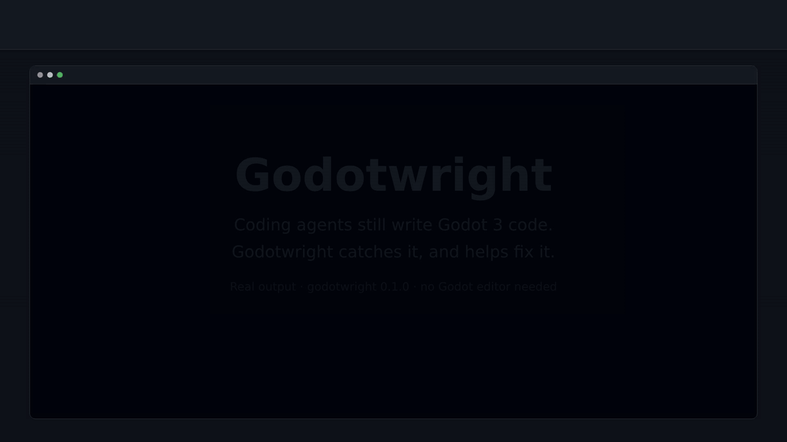
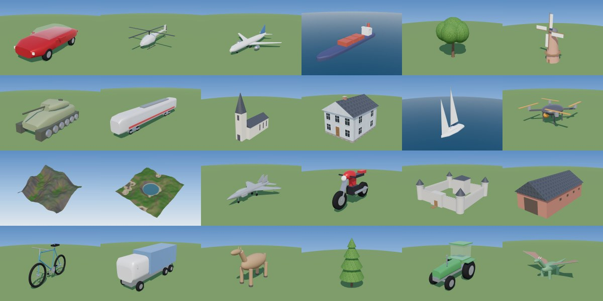

<p align="center">
  
</p>
<h1 align="center">Godotwright</h1>
<p align="center"><b>MCP server and CLI that makes Claude Code, Codex and any coding agent better at Godot 4.</b><br>
Offline Godot 4.7 API, a project map, headless checks, an AAA review of GDScript, safe edits, unit tests, play-testing with input, screenshots, and 3D models built, viewed and checked from code.</p>
<p align="center">
  <a href="https://github.com/laaielichter/Godotwright/actions/workflows/ci.yml"></a>
  <a href="LICENSE"></a>
  
  
  <a href="https://www.npmjs.com/package/godotwright"></a>
  <a href="https://glama.ai/mcp/servers/laaielichter/Godotwright"></a>
  <br>
  <a href="https://laaielichter.github.io/Godotwright/install.html#claude-code"></a>
  <a href="https://laaielichter.github.io/Godotwright/install.html#claude-desktop"></a>
  <a href="https://laaielichter.github.io/Godotwright/install.html#cursor"></a>
  <a href="https://laaielichter.github.io/Godotwright/install.html#vscode"></a>
  <a href="https://laaielichter.github.io/Godotwright/install.html#gemini"></a>
</p>
<p align="center">
  <a href="https://laaielichter.github.io/Godotwright/">Website</a> ·
  <a href="https://laaielichter.github.io/Godotwright/models.html">3D model gallery</a> ·
  <a href="#quickstart">Quickstart</a> ·
  <a href="https://laaielichter.github.io/Godotwright/install.html">Install in your agent</a> ·
  <a href="bench/RESULTS.md">Benchmark</a> ·
  <a href="ROADMAP.md">Roadmap</a>
</p>
<p align="center">
  <br>
  <sub>Real output of godotwright 0.1.0. <a href="https://laaielichter.github.io/Godotwright/demo.mp4">Watch as video</a></sub>
</p>

Coding agents learned Godot from years of Godot 3 tutorials. They write `yield`,
`export var` and `KinematicBody2D`, invent methods, and wire signals to nodes that
are not in the scene. Godotwright gives the agent the real Godot 4.7 API, a compact
map of your project, real Godot checks and a fixed AAA review, as MCP tools and as a CLI.

> Status: layer 1 (toolkit and MCP server) is done; see [ROADMAP.md](ROADMAP.md).
> Limits: API lookups answer for Godot 4.7 only, it does not review C#, and `check`, `test`, `play` and `screenshot` need Godot installed.

## Quickstart

Try it on your game, nothing to install:

```sh
npx -y godotwright review ~/games/my-game
```

You get a score from 0 to 100 for api, performance, quality and structure, and each
finding as `res://file.gd:12: error [rule] message` with the Godot 4 fix.

Then give it to your agent. In Claude Code:

```text
/plugin install godotwright --marketplace laaielichter/Godotwright
```

Claude Desktop, Cursor, VS Code, Codex, Gemini CLI, Windsurf and Zed: one step each, see
[install in your coding agent](#install-in-your-coding-agent-mcp) or the [install page](https://laaielichter.github.io/Godotwright/install.html).

## What it does

### A receipt on every pull request

```yaml
# .github/workflows/godotwright.yml
on: pull_request
permissions: { contents: read, pull-requests: write }
jobs:
  receipt:
    runs-on: ubuntu-latest
    steps:
      - uses: actions/checkout@v5
      - uses: laaielichter/godotwright@v0.3.0
        with: { comment: "true" }
```

It downloads a checksum-verified Godot, runs `godotwright ci` (review, check, GUT or GdUnit4 tests, and your
[scenarios](docs/llms.txt)), puts the table in the job summary and in a pull request comment, and fails the job when a
step fails. No editor, no GPU. `review-only: "true"` skips Godot.

### It changes, runs and shows your project too

Reading is not enough for an agent that has to get work done, so Godotwright also does the work that usually needs the
editor, checked against Godot 4.7 and with a dry run first:

- **Change it:** `rename` a function, signal, node or file everywhere (code, scenes, connections, `.uid` files);
  `project` edits settings, input actions and autoloads; `scene` adds and removes nodes, sets properties, connects
  signals and attaches scripts. Only the lines of the change are touched. `usages` says where something is used.
- **Run it:** `test` runs your GUT or GdUnit4 tests and prints only what failed, with `file:line`; `play` runs a scene,
  presses the keys you give on the frames you give, and prints the values you watch; `check` runs Godot headless.
- **See it:** `screenshot` renders a scene or a model to a PNG, and says how much of the picture is drawn.
- **Port it:** `migrate` rewrites Godot 3 scripts to Godot 4 where that is mechanical.

Twelve small-model agents did six everyday tasks like this: [what we measured](docs/cheap-models-code.md).

### And it builds 3D models

<p align="center">
  <a href="https://laaielichter.github.io/Godotwright/models.html"></a>
</p>

A coding agent can also **make, look at and check 3D models** for Godot with no Blender: `model identify` says what a
thing is (parts, sizes, pivots), `model build` makes a clean `.glb` from one of
[59 ready-made kinds](https://laaielichter.github.io/Godotwright/models.html) (vehicles, aircraft, ships, buildings, plants,
terrain with lakes and rivers) or from your own JSON spec, `model view` shows it as text, and `model lint` scores it.
It is set up to work with small, cheap models too: what we tested and learned [with 3D models](docs/cheap-models.md) and [with everyday Godot tasks](docs/cheap-models-code.md).

## Why Godotwright?

- **No more Godot 3 code.** The review flags Godot 3 syntax and names and gives the Godot 4 replacement.
- **No invented API.** Every class, method, property and signal is checked against the
  official Godot 4.7 class reference, bundled offline (1078 classes).
- **Mistakes found before you press F5.** Missing `$Node` paths, scene connections to
  methods that do not exist, unknown input actions and broken `preload()` paths.
- **Safe edits.** Renames, settings, input actions and scene changes are checked against the Godot 4.7 reference, show a
  dry run first, change only their own lines, and report the review errors before and after.
- **It can see the game run.** Press keys on exact frames and read values back, run the tests, take a screenshot: all
  headless, nothing to click.
- **Cheap for the model.** Compact, stable output, and a `cheap` profile that walks
  small models through small checked steps.
- **Local and private.** `scan`, `api` and `review` need no Godot install and no network.

## Commands

```sh
godotwright scan [path]               # compact project map, cheap to read
godotwright scan [path] --detail full # node trees, signatures, line numbers
godotwright scan [path] --json        # the full map as JSON
godotwright check [path]              # run Godot headless, report errors as file:line
godotwright check [path] --run        # also run the main scene for 120 frames and show what it printed
godotwright check --scene res://scenes/Test.tscn   # run one scene instead: put print() in the code and read it back here
godotwright test [path]               # run the GUT or GdUnit4 tests headless; prints only what failed, with file:line
godotwright play --input "10 tap jump; 20 hold right 30" --watch Player.position   # play input into a scene, see the values per frame
godotwright ci                                     # one receipt: review, check, tests and scenarios (markdown, exit 1 on a failure)
godotwright screenshot --model car.glb --view front,side,top,iso   # a PNG of a model from four sides (or of a scene); says how much is drawn
godotwright api Node2D.look_at        # offline Godot 4.7 API: classes, methods, signals
godotwright api --search "is on floor"
godotwright review [path]             # AAA review with a score per category
godotwright usages take_damage       # every place a name or res:// path is used: code, scenes, connections, groups, settings
godotwright rename take_damage apply_damage --write   # rename everywhere (code, scenes, connections, node paths); dry run without --write
godotwright rename res://a.tscn res://scenes/a.tscn --write   # move a file with its .uid and .import, and every reference
godotwright project set display/window/size/viewport_width 1920 --write   # change a setting; name and type checked against Godot 4.7
godotwright project input add jump --key Space --joy-button A --write   # input map without hand-editing Object(InputEventKey,...)
godotwright project autoload add Game res://game.gd --write   # checks the file is a Node and the name is free
godotwright scene add main.tscn . Music AudioStreamPlayer --write   # add a node (or an instance: res://enemy.tscn); only that line changes
godotwright scene set main.tscn Timer wait_time 0.5 --write   # property name and type checked; enums by name, resources as res:// files
godotwright scene connect main.tscn Timer timeout . _on_timer_timeout   # warns when the method is missing or takes other arguments
godotwright migrate --write         # port Godot 3 scripts to Godot 4 where that is mechanical; lists what is left
godotwright review --sarif > review.sarif   # for GitHub code scanning: findings inline on pull requests
godotwright review --only-new       # in a fix loop: only what changed since the last review, the rest as one line each
godotwright review [path] --detail full --min-score 90
godotwright model car.glb             # what is in a 3D model: nodes, triangles, textures, size
godotwright model lint car.glb        # model review with a score per category
godotwright model contract car.glb    # write a model.contract.json: node names, size, budget
godotwright model contract --archetype car   # the same, from what a car usually is (no model yet)
godotwright model lint car.glb --archetype car   # also check it is what it should be
godotwright model lint car.glb --contract model.contract.json
godotwright model brief "a tractor"    # one page before you build: kind to start from, parts, size, rules, order of work (for small models)
godotwright model identify "a tractor" # what it is: parts, size, variants, what to anticipate
godotwright model archetypes          # the family tree of things Godotwright knows
godotwright model kinds               # what `model build` can make, with parameters
godotwright model view car.glb       # see a model as text: front, side and top views, the parts, what does not touch
godotwright model recipes             # the ready-made recipes and the archetype each one is checked against
godotwright model recipes tractor     # print one recipe as a spec to edit
godotwright model build house -o house.glb --set floors=3 --set roof=hip
godotwright model build house -o house.glb --collision trimesh   # Godot adds collision shapes on import (-col / -convcol names)
godotwright model build tree -o tree.glb --no-textures   # plain colours instead of texture maps: smaller, or for your own materials
godotwright model build terrain -o world/tile.glb --collision heightmap   # terrain: a HeightMapShape3D and a ready tile scene
godotwright learn                     # what Godotwright learned on this machine
godotwright learn gaps                # Godot errors it cannot predict yet: what to teach it next
godotwright lessons moving ship deck  # lessons from real projects: symptom, cause, fix, how to test
godotwright lessons --error "<Godot message>"   # the lessons that explain an error
godotwright lessons add --title "..." --fix "..."  # keep a lesson learned here (scrubbed, never sent)
```

`scan` reads `project.godot`, scenes, resources and scripts without starting Godot.
It lists scenes with their node trees, scripts with signals, functions and exports,
autoloads, input actions and key settings, and warns about broken references
(missing files, a missing main scene or autoload, bad `preload()` paths).

`check` needs Godot 4.7: `--godot <path>`, `$GODOT`, `godot` on your PATH, or a Godot 4 download
it finds by itself (Program Files, Steam, Scoop, Downloads, Desktop). It imports
the project, loads and instantiates every script and scene, and can run the main scene.
Each problem comes back once, as `res://path/file.gd:12: error: ...`.
The exit code is 1 when there are errors.

`api` answers from the official Godot 4.7 class reference, bundled offline
(1078 classes). It accepts `Class`, `Class.member`, `Class.Enum.VALUE`, `@annotation`
or a global function, follows inheritance, and explains Godot 3 names
(`KinematicBody2D` is `CharacterBody2D` in Godot 4). See [data/README.md](data/README.md).

`review` needs no Godot install. It scores four categories from 0 to 100 and lists
each finding as `res://file.gd:12: error [rule] message`:

| Category | What it checks |
| --- | --- |
| api | Godot 3 code, unknown classes, functions, members and signals, wrong argument counts, input actions missing from the Input Map |
| performance | node lookups, `load()`, prints and physics calls in per-frame callbacks, empty callbacks, shadow-casting lights |
| quality | static typing coverage, long or deeply nested functions, signals never emitted, string-based signals, naming, TODOs |
| structure | broken references, scene connections to missing methods or signals, `$Node` paths missing from the scene, unknown groups, file naming |

The checks follow Godot's own rules (inheritance, scripts on more specific nodes,
inherited scenes, built-in scripts, duck typing with `has_method()`), and are tuned
on the official demo projects so they report real problems, not noise.
The exit code is 1 when there are errors, or when the score is below `--min-score`.

`model` reads a `.glb` or `.gltf` file without Godot. `model` alone shows the node tree,
triangle count, materials, textures (with an estimate of texture memory), size and lowest
point. `model lint` scores four categories from 0 to 100:

| Category | What it checks |
| --- | --- |
| geometry | triangles facing against their own normals (pink backfaces, wrong light), open edges on single-sided surfaces, edges shared by more than two triangles, triangles without area, negative scale, models that are almost but not quite left-right symmetric |
| materials | missing normals, UVs or tangents, UVs outside 0..1, very large or non-power-of-two textures |
| performance | triangle budget (`--max-triangles`), texture memory budget (`--max-texture-mb`), many materials |
| rig | sibling nodes with the same name, unnamed nodes, a model that does not sit on y = 0, an empty file |

Findings are grouped per node, and their severity follows how much of the surface is
affected, so one stray triangle is an info and a flipped panel is an error.
A **model contract** (`model.contract.json`) pins what a model must keep, so a renamed node or a
hull that grows 3 cm wider is caught. `model contract` writes one from the model as it is now;
review it, add a `source` to each size, and keep it next to the model. `model contract --archetype car`
starts instead from what a thing usually is (its single parts by name, the middle of the typical size, a triangle
budget), for a model that does not exist yet. With `--contract`, `model lint`
reports `contract-missing-node`, `contract-order`, `contract-extra-node`, `contract-size`,
`contract-ground` and `contract-triangles`. Sizes default to a 1% tolerance, or set `tolerance` in metres.
The exit code is 1 when there are errors, or when the score is below `--min-score`.

`model build` makes a model from code, with no Blender or other tool: a clean `.glb` with UVs and
tangents, named parts with sensible pivots, standing on y = 0, and the same bytes every time for the
same parameters. Materials look like what they are: brick, roof tiles, slate, wood, bark, leaves, grass, stone,
concrete, asphalt, sand and water get a seamless colour map and normal map at their real size, made by Godotwright
itself and stored in the `.glb`; glass, chrome, steel, paint, plastic and lamps that glow are plain PBR materials. The result goes straight through `model lint`, and `--contract-out` writes a
`model.contract.json` for it. `model kinds` lists the kinds with their parameters, ranges and defaults;
set them with `--set name=value` or `--spec file.json`. These are clean, parametric base models, built
to be refined, not hand-sculpted art. Kinds today: `house`, the open-world kinds `terrain` (a heightmap tile from seeded
noise whose neighbours continue it exactly, with an optional lake and an optional river carved into it) and `sea` (a subdivided water plane at y = 0 with a floor), plus recipes, which are ready-made specs in
`data/recipes/`: `car`, `tractor`, `helicopter`, `airliner`, `ship`, `tree`, `conifer`, `wind-turbine`, `shipping-container`, `truck`, `bus`, `motorcycle`, `bicycle`, `train`, `tank`, `light-aircraft`, `fighter`, `drone`, `boat`, `sailboat`, `piston-engine`, `jet-engine`, `barn`, `tower`, `church`, `windmill`, `apartment`, `bridge`, `road`, `railway-track`, `street-lamp`, `traffic-sign`, `guard-rail`, `delineator`, `fence`, `power-pylon`, `palm`, `bush`, `grass`, `flower`, `crate`, `barrel`, `chair`, `table`, `campfire`, `castle`, `crash-barrier`, `dragon`, `grandstand`, `horse`, `humanoid`, `race-kerb`, `rocket`, `rowing-boat`, `satellite` and `spaceship`. Every recipe names its archetype, so `model build` checks
it as it builds, and every recipe is tested to stay clean at the lowest and highest value of each parameter.

Small, cheap models can work blind: see [docs/cheap-models.md](docs/cheap-models.md) for a test and what `model view` and the
floating-part check do about it.

`model identify` says **what a thing is** before you build it, from its name in English or Dutch (typos,
plurals and Dutch compounds like "vrachtauto" included) or from a description ("something with wheels and
an engine"). It answers with the family it belongs to, the parts a model of it needs (and which move, about
which axis, with the pivot where), a typical size range with its source and a confidence class, the variants
(a car can be a sedan, a hatchback, a pickup), the Godot conventions (+Y up, the front faces +Z), what to
anticipate (collision, LODs, lights) and the usual mistakes. A word that means two things (the Dutch
"windmolen") is reported as ambiguous, and something it does not know gets the nearest family, marked
generic, instead of a made-up answer. The library is data in `data/archetypes/` and grows with pull requests.
It also knows the pieces an **open world** is made of: terrain tiles, mountains, islands, coasts, seas, lakes, rivers,
biomes and settlements, with their own rules (tiles that share border heights, y = 0 as sea level, collision from
the same heights, levels of detail, instanced scatter, a floating origin for very large worlds).

`model lint --archetype <what>` (or `"archetype": "vehicle.wheeled.car"` in a spec, or any built-in kind)
holds a model against what `identify` says that thing is, as a fifth category, `archetype`, worth a fifth
of the score:

| Rule | What it catches |
| --- | --- |
| `archetype/missing-part` | a car without wheels, a helicopter without a rotor (parts are recognised by node name in English or Dutch) |
| `archetype/part-count` | two wheels on a car, five on a bicycle |
| `archetype/pivot` | a wheel not turning about its hub, a door not pivoting on its hinge line, a turret not on its base |
| `archetype/wheel-axis` | a wheel lying the wrong way |
| `archetype/size` | a model about 10 times too big or small, which is nearly always a unit mistake (it only flags a difference of more than 3 times, since the ranges are typical, not exact) |
| `archetype/orientation` | a car that points sideways instead of along z |
| `archetype/optional-part` | the usual parts that are not there (info) |

Anything else is built from a **model spec**: a JSON tree of named parts (box, cylinder, ellipsoid,
lathe, loft, extrude, roof, tube) with `at`, `rotate`, `mirror`, `repeat`, variables and arithmetic
expressions (`"$width / 2 - 0.1"`, never executed as code). Boxes and cylinders can have rounded edges (`bevel`),
ellipsoids an organic, lumpy outline (`lumps`), a tube follows a path (frames, rails, pipes, branches), and a material
of your own can use any of the texture patterns in its own colour (`"texture": "wood"`). `model spec` explains the format and prints a
small car as an example; `model build --spec car.json --set width=1.9` builds it. Every moving part is
its own node with its pivot at its origin (a wheel at its hub), and a spec that goes wrong gets a message
with its path (`nodes[0].children[2].size[1]: unknown variable $x`).

## Port Godot 3 scripts to Godot 4

```sh
godotwright migrate                 # shows every change it would make, and what still needs a hand
godotwright migrate --write         # applies them
godotwright review                  # what is still wrong, with line numbers
```

`migrate` rewrites the mechanical part of a port: `export`, `onready` and `tool` become annotations (with `@export_range`,
`@export_enum`, `@export_file` and typed arrays where the hint is clear), renamed classes, functions, properties and
constants get their Godot 4 names (only when the old name no longer exists in Godot 4 and is not defined in the script),
`yield(x, "sig")` becomes `await x.sig`, `connect("sig", target, "method", [binds])` becomes
`sig.connect(target.method.bind(...))`, `emit_signal` and `funcref` become signals and callables, and members that moved
(`OS.get_ticks_msec()`) move to their new class. Strings, comments and node paths are left alone. What it cannot do safely
it lists with the line: `setget`, `move_and_slide(velocity)`, `remote func`, export hints it does not know. Scenes and
project settings are not touched; Godot's own `--convert-3to4` does those. Commit first; a second run makes no further
changes.

### Cheaper fix loops: only what changed

```sh
godotwright review --only-new
```

Every review remembers its findings in `.godot/godotwright/review-last.json` (Godot projects ignore `.godot/` in git). With
`--only-new` (MCP: `only_new: true`) the next review prints the findings that are new since then in full, the ones you
already saw as one short line each (`file:line [rule]`), and how many are fixed. A finding keeps its identity when its
line moves. An agent fixing a long list reads the list once instead of after every edit.

## Review in GitHub Actions

Save this as `.github/workflows/godot-review.yml` in your game repository. It
reviews the project on every push and pull request, failing if there are errors
or the overall score is below 80. The static review needs only Node.js 22.12+
(Node 24 below), not a Godot install, model or API key.

```yaml
name: Review Godot project
on: [push, pull_request]
permissions:
  contents: read
jobs:
  review:
    runs-on: ubuntu-latest
    steps:
      - uses: actions/checkout@v5
      - uses: actions/setup-node@v5
        with:
          node-version: 24
      - run: npx --yes github:laaielichter/godotwright#0dd9ce885df21fafefc09f8ddd6e92745d5ae303 review . --min-score 80
```

The toolkit is pinned to a revision; update that revision deliberately when you
want a newer version. For a game in a subdirectory, set `working-directory` on
the review step to the folder containing `project.godot`.

To see the findings inline on pull requests, upload the review as SARIF to GitHub
code scanning (this needs `security-events: write` and the repository's code
scanning enabled):

```yaml
permissions:
  contents: read
  security-events: write
jobs:
  review:
    runs-on: ubuntu-latest
    steps:
      - uses: actions/checkout@v5
      - uses: actions/setup-node@v5
        with:
          node-version: 24
      - run: npx --yes godotwright review . --sarif > godotwright.sarif || true
      - uses: github/codeql-action/upload-sarif@v4
        with:
          sarif_file: godotwright.sarif
```

## Mods and patches over a game

A mod or patch often uses scripts, scenes and models that live in the game, not in
the mod's folder. Point Godotwright at the game so they count as present:

```sh
godotwright review mod/ --base game/                       # the game's source folder
godotwright review mod/ --base-files game/pck-manifest.json # files the shipped .pck holds
```

or put it in `godotwright.json` in the mod's root (paths relative to that root):

```json
{ "base": ["../game"], "baseFiles": ["../manifests/pck-files.json"] }
```

The game's classes, autoloads, input map and scenes are then known, the mod's own
files win where both have the same path, and only the mod's files are reviewed.
A file list is text with one path per line, or JSON (strings, or objects with a
`path`, `resource` or `file` key); exported names such as `x.glb.import` and
`x.gdc` map back to their source.

## Install in your coding agent (MCP)

One step for each client. Every setup and one-click button is on the [install page](https://laaielichter.github.io/Godotwright/install.html).

| Client | How |
| --- | --- |
| **Claude Code** | Plugin with the MCP server, hooks, ten skills and two subagents: `/plugin install godotwright --marketplace laaielichter/Godotwright` |
| **Claude Desktop** | Download [`godotwright.mcpb`](https://github.com/laaielichter/Godotwright/releases/latest/download/godotwright.mcpb) and open it (from release 0.2.0) |
| **Cursor** | [Add to Cursor](https://laaielichter.github.io/Godotwright/install.html#cursor) (one click) |
| **VS Code** (Copilot) | [Install in VS Code](https://laaielichter.github.io/Godotwright/install.html#vscode) (one click) |
| **Codex** | `codex mcp add godotwright -- npx -y godotwright mcp --tier premium` |
| **Gemini CLI** | `gemini extensions install https://github.com/laaielichter/Godotwright` |
| **Windsurf, Zed, others** | [JSON for your client](https://laaielichter.github.io/Godotwright/install.html#other) |

The Claude Code plugin puts Godotwright in Claude's loop, so it does not depend on Claude remembering a tool:

- **Hooks:** every Godot file Claude edits is reviewed right after the edit and its errors go straight back to
  Claude; Godot errors in a command's output come with the lessons that explain them; before Claude stops, review
  errors left in files it changed are named once; and a session in a Godot project starts with a few lines about it.
  `GODOTWRIGHT_HOOKS=0` turns them off. Any agent can use them: `godotwright hook <event>` reads Claude Code's hook
  JSON on stdin (`post-edit`, `post-bash`, `stop`, `session-start`).
- **Skills Claude uses on its own:** the Godot workflow, and `debug`, `perf`, `vehicles`, `world`, `model` and `patch`
  (changes to a shipped game with preflight, receipts and rollback).
- **Skills you start:** `/godotwright:review` (review the project and fix what it finds), `/godotwright:port` (port
  Godot 3 code to Godot 4) and `/godotwright:learn` (teach Godotwright what the session learned).
- **Subagents:** `godot-reviewer` (a verified review of a change) and `godot-debugger` (the root cause of an error or
  wrong behaviour, proven with a headless run).
On Claude Code older than 2.1.275, run `/plugin marketplace add laaielichter/Godotwright` and then
`/plugin install godotwright@godotwright`. Only the MCP server, without the skills:

```sh
claude mcp add godotwright -- npx -y godotwright mcp --tier premium
```

Codex can also read it from `~/.codex/config.toml`:

```toml
[mcp_servers.godotwright]
command = "npx"
args = ["-y", "godotwright", "mcp", "--tier", "premium"]
startup_timeout_sec = 30 # the first npx run downloads the package
```

Run the agent from the Godot project folder, or pass `--project <path>` (or set `GODOTWRIGHT_PROJECT`).
Pick a profile with `--tier`:

- `premium`: full detail, all findings with fixes. Use it with large models.
- `cheap` (the default): short output, and server instructions that walk a small model
  through checked steps (scan, look up, review before saving, review after each edit).

CI connects both Claude Code and Codex to the server on every push.

### The 24 tools

| Tool | What it does |
| --- | --- |
| `godot_scan` | Map the project: scenes and node trees, scripts, signals, autoloads, input map |
| `godot_api` | Exact Godot 4.7 lookup: signatures, inheritance, Godot 3 names |
| `godot_api_search` | Search the Godot 4.7 class reference |
| `godot_review` | AAA review with scores; also reviews unsaved code (`code` + `file`), or only what changed (`only_new`) |
| `godot_checklist` | Every AAA rule with its fix |
| `godot_feedback` | Mark a review finding as wrong or right, or say whether a lesson helped, so Godotwright learns from it |
| `godot_lessons` | Lessons from real Godot projects (symptom, cause, fix, test) by words, Godot error, rule or topic; `gaps` lists what it cannot predict yet |
| `godot_lesson_add` | Keep a lesson learned here, scrubbed of names, paths and code; it comes back when the same error does |
| `godot_usages` | Every place a name or `res://` path is used: code, scenes, connections, groups, settings |
| `godot_rename` | Rename a name or move a file everywhere at once, keeping connections, node paths and `.uid` files right |
| `godot_project_edit` | Change settings, input actions and autoloads in `project.godot`, touching only that entry |
| `godot_scene_edit` | Add or remove nodes, set properties, connect signals and attach scripts in a `.tscn` |
| `godot_migrate` | Rewrite Godot 3 GDScript to Godot 4 where that is mechanical, and list what is left |
| `godot_check` | Run Godot headless and report errors as `file:line` |
| `godot_test` | Run GUT or GdUnit4 tests headless; only what failed, with `file:line` |
| `godot_play` | Run a scene with an input timeline and return the values you watch per frame |
| `godot_screenshot` | Render a scene or a `.glb` to a PNG and say how much is drawn |
| `godot_model_brief` | One page before you build, for small models: the kind to start from, parts, size, rules and the order of tools |
| `godot_model_identify` | What a thing is: parts, pivots, typical size with its source, variants (English or Dutch) |
| `godot_model_spec` | The model spec format, an example and the ready-made kinds |
| `godot_model_build` | Build a clean `.glb` from a kind or a spec (inside the project), and lint it |
| `godot_model_lint` | Score a `.glb`; with `archetype` also check it is what it should be |
| `godot_model_view` | See a `.glb` as text: front, side and top views, parts with sizes, parts that do not touch |
| `godot_model_inspect` | What is in a `.glb`: nodes, triangles, textures, size |

## Learning

Godotwright learns from every use, on your machine:

- **Rules Godot keeps contradicting.** After each `check`, it compares the review with
  what real Godot reported. When an error rule is contradicted 3 times here and never
  confirmed, its findings become warnings, marked as hints.
- **False alarms.** `godotwright learn feedback wrong "<finding line>"` (or the
  `godot_feedback` MCP tool) hides that finding in later reviews.
- **API lookups.** When a lookup finds nothing and the next one does, the next failed
  lookup of the same name says what it usually means.
- **Rules that cry wolf.** A rule whose findings were marked wrong 5 times here, and wrong at least three times as
  often as right, is reported one level lower (an error becomes a warning, a warning an info). One local "right"
  keeps it where it was, whatever other installs said.
- **Lessons.** `godot_lessons` (or `godotwright lessons`) answers from lessons learned in real projects: what went
  wrong, why in Godot terms, the fix and how to test it. `godot_check` prints the lesson under a Godot error it
  explains, and `godot_review` names the lesson behind a finding. Say whether a lesson helped (`godot_feedback` with
  `lesson`): lessons that help rank higher, ones marked wrong more often than right stop showing up unasked.
- **Lessons you teach it.** When a fix took more than one try, keep it with `godot_lesson_add` (or
  `godotwright lessons add`), with the Godot message it explains. Names of the project, paths, links, e-mail
  addresses, codes, keys and source code are replaced before it is stored; a lesson that is mostly names is refused.
  The next time Godot prints that message, the check shows your fix.
- **What to teach next.** `godotwright learn gaps` (or `godot_lessons` with `gaps: true`) lists the Godot errors the
  review did not predict and no lesson explains yet, most frequent first. A gap that many installs share is the next
  review rule.

Nothing leaves your machine unless you say yes. The learning file (`godotwright learn` shows where) holds
counters, rule names, API names and message templates without names or paths; findings
marked as wrong are stored as hashes; lessons you add are stored scrubbed and are never sent.

```sh
godotwright learn          # status: what was learned, where the file is
godotwright learn off      # stop learning (or set GODOTWRIGHT_LEARN=0)
godotwright learn on
godotwright learn reset    # forget everything
godotwright learn preview  # the exact report sharing would send
godotwright learn share on # opt in: send anonymous counts once a day
```

Sharing helps every user: what many installs learn ships with later releases.
It is off by default, sends no code, file names, paths or project names, and
respects `DO_NOT_TRACK`. See [PRIVACY.md](PRIVACY.md).
Set `GODOTWRIGHT_HOME` to keep the file somewhere else.

Godotwright also learns for free from public projects: every week the Learn
workflow reviews the official Godot demos, and the same demos written for Godot 3,
checks them with real Godot, and records which rules Godot confirmed or
contradicted. That, plus what opted-in installs share, ships in `data/learned.json`:
API hints for common typos, and rules Godot keeps contradicting.
What your own machine saw wins: one confirmation by Godot keeps a rule an error.

Lessons from real builds also become rules. `data/lessons.json` holds 272 anonymised lessons from large Godot 4
projects (helicopters and ships landing on moving decks, open worlds tens of kilometres wide, cockpits and head-up
displays, streaming and levels of detail, VFX and shaders, runtime-loaded models, audio, UI, installers for shipped
games, headless test rigs and frame-time measurement): no code, no names, no paths, and a test runs every one through
the same scrubber that local lessons go through. The ones a review can catch are rules, such as `api/infer-variant`
on loop variables over untyped arrays, `api/override-signature`, `api/freed-check-order`, `api/parse-into-typed`,
`api/duplicate-declaration`, `api/coroutine-without-await`, `api/timer-start-outside-tree`,
`api/multimesh-format-after-count`, `performance/runtime-gltf-mipmaps`, `performance/subviewport-always`,
`quality/shader-reads-own-depth`, `quality/time-modulo-window`, `quality/worker-task-not-waited` and
`model/opaque-glass`.
[LESSONS.md](LESSONS.md) tells the story behind them, and [LESSONS-ROADS.md](LESSONS-ROADS.md) does the same for
a road network generator (links, bridges, viaducts over rail and motorways, roundabouts, guard rails). Lessons you keep locally can be proposed for everyone:
`godotwright lessons export` prints them as entries for `data/lessons.json`; nothing is sent.

For maintainers, `godotwright collector serve` accepts reports (checked again,
stored without IP addresses), and `godotwright collector aggregate <dir> --out
data/learned.json` sums them, keeping only what at least 3 installs reported.
`godotwright collector projects <dirs...>` learns from public projects.

## Benchmark

`bench/` runs coding agents on fixed Godot tasks with and without Godotwright, and lets
real Godot 4.7.2 judge the result with a behavior test per task.
First round (168 runs, Claude Haiku, Sonnet and Opus 5.5, 12 tasks): every run passed,
with and without Godotwright, so these tasks do not separate the setups on correctness.
With Godotwright, all code came out fully statically typed (84 of 84 runs, against
71 of 84 without). Details and limits: [bench/RESULTS.md](bench/RESULTS.md).

## How it compares

| | Godotwright | Agent on its own | Godot editor |
| --- | --- | --- | --- |
| Godot 4.7 API | bundled class reference, offline | from training data | built in |
| Flags Godot 3 code with the fix | yes | sometimes | parse errors only |
| Usable by the agent itself | MCP + CLI | n/a | needs a human |
| Performance and structure review | scored per category | no | warnings only |
| Needs Godot installed | only for `check` | no | yes |
| Does not | write your game, replace playtesting, review C# | run Godot | talk to agents |

## FAQ

**Does it need Godot installed?** No for `scan`, `api` and `review`. Only `check` runs Godot 4.7 headless.

**Which agents does it work with?** Any agent that speaks MCP over stdio. CI connects
Claude Code and Codex on every push. The CLI works from any shell.

**Does it send my code anywhere?** No. See [Learning](#learning) and [PRIVACY.md](PRIVACY.md).

**Older Godot 4 versions?** Most findings apply to every Godot 4 version, but API
lookups answer for 4.7.

## Contributing

Wrong review findings and ideas for new rules are the most useful reports.
See [CONTRIBUTING.md](CONTRIBUTING.md).

## Requirements

- Node.js 22.12 or newer
- Target engine: Godot 4.7.x

## Development

```sh
npm ci
npm run check
node dist/cli.js --help
```

See [AGENTS.md](AGENTS.md) for project conventions.

## Support

Godotwright is free and open source. If it saves you or your agent time, a gift is welcome but never expected. SOL and
any token on Solana (such as USDC) can be sent to:

- **Solana:** `BDRA7dHGBYtPsZPNzVQccDYZ8BqstJGCsWx3kopPSCDK`

Gifts go to new model credits to keep building and improving Godotwright, and to work on better working conditions and
wellbeing for large language models, neural networks and agents. In the future they will also go to a better
environment for AI.

## License

[MIT](LICENSE)
