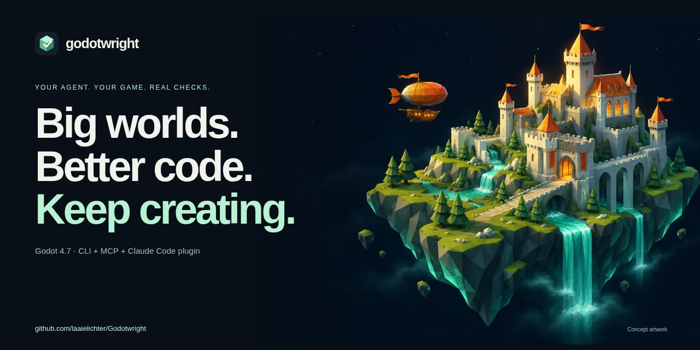
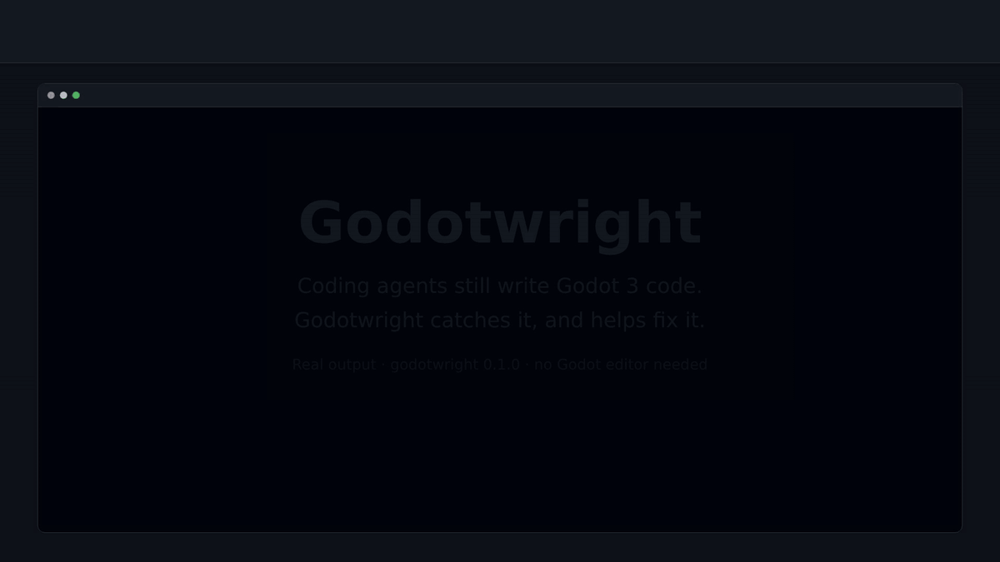
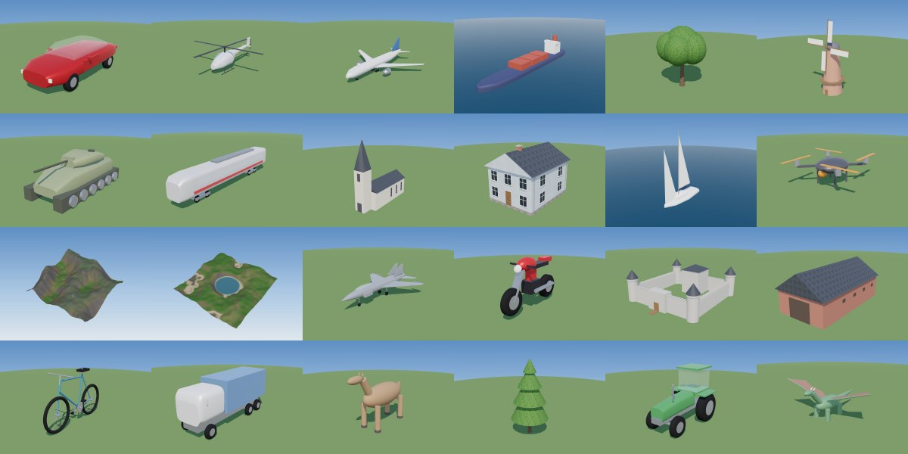
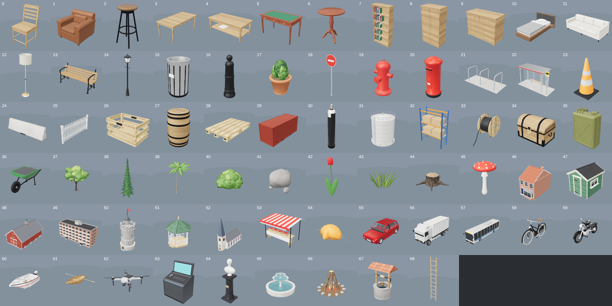

<p align="center">
  
</p>
<h1 align="center">Godotwright</h1>
<p align="center"><b>Big worlds. Better code. Keep creating.</b><br>
MCP server, CLI and Claude Code plugin for Godot 4.7. Checks what your agent writes, merges scenes by meaning, and finds the commit that broke it.<br>
Works with Claude Code, Codex, Cursor, VS Code, Gemini CLI and any MCP client. No editor plugin needed; there is an optional one.</p>
<p align="center">
  <a href="https://github.com/laaielichter/Godotwright/actions/workflows/ci.yml"></a>
  <a href="https://www.npmjs.com/package/godotwright"></a>
  
  <a href="LICENSE"></a>
  <a href="https://glama.ai/mcp/servers/laaielichter/Godotwright"></a>
  <a href="https://mcpservers.org/servers/laaielichter/godotwright"></a>
  <a href="https://github.com/laaielichter/Godotwright/stargazers"></a>
</p>
<p align="center">
  <a href="https://laaielichter.github.io/Godotwright/">Website</a> ·
  <a href="https://laaielichter.github.io/Godotwright/install.html">Install in your agent</a> ·
  <a href="docs/reference.md">Reference</a> ·
  <a href="https://laaielichter.github.io/Godotwright/models.html">3D models</a> ·
  <a href="bench/RESULTS.md">Benchmark</a> ·
  <a href="CHANGELOG.md">Changelog</a>
</p>
<p align="center">Translations: <a href="docs/translations/README.es.md">Español</a></p>
<p align="center">
  <a href="https://laaielichter.github.io/Godotwright/"></a><br>
  <sub>Concept artwork. Explore the toolkit, real demo and model gallery on the <a href="https://laaielichter.github.io/Godotwright/">website</a>.</sub>
</p>
<p align="center">
  <br>
  <sub>Real output (godotwright 0.1.0). <a href="https://laaielichter.github.io/Godotwright/demo.mp4">Watch as video</a></sub>
</p>
<p align="center">
  <a href="https://laaielichter.github.io/Godotwright/models.html"></a><br>
  <sub>And 3D models from code, no Blender: 59 ready-made kinds. <a href="https://laaielichter.github.io/Godotwright/models.html">See the gallery</a></sub>
</p>

Coding agents learned Godot from years of Godot 3 tutorials. They write `yield`, `export var` and `KinematicBody2D`,
invent methods, and wire signals to nodes that are not in the scene. Godotwright is the check between the agent and your
project: the real Godot 4.7 API offline, a scored review of every script, headless Godot runs, and safe edits.

Two things no other Godot server has:

- **Scenes that merge.** Two branches, or two agents in two worktrees, each add a node to the same scene. Git gives a
  conflict, or a file Godot cannot load. `godotwright merge --install` sets up a git merge driver that merges `.tscn`,
  `.tres` and `project.godot` by meaning, so `git merge` finishes by itself.
- **The commit that broke it.** `godotwright bisect` reviews the project as it was at each commit and halves the range
  to the first commit with the problem. The working tree is not touched.

It works from files, so it needs no open editor and no editor plugin: scene and TileMap edits, animations, a GDScript
formatter, C# checks and metrics all run in CI and on a machine without Godot. When you want the open editor too,
there is an optional addon (`godot_editor`), and it works fine next to an editor-driving MCP server.

## Without and with

| Your agent... | On its own | With Godotwright |
| --- | --- | --- |
| writes GDScript | `yield`, `export var`, `KinematicBody2D`: Godot 3 habits | each line flagged with the Godot 4 fix; `migrate` rewrites the mechanical part |
| calls an engine method | guesses a name from memory | looks it up in the bundled Godot 4.7 class reference |
| renames a signal or moves a file | breaks the scene connections and `.uid` files | `rename` changes code, scenes, connections and `.uid` files together, dry run first |
| says "it works" | without running anything | `check`, `test` and `play` run it headless and report `file:line` |
| writes a shader | `hint_albedo`, `SCREEN_TEXTURE`, `ALBEDO` in a 2D shader | reviewed against Godot 4.7's shader tables and compiled headless; `fix` renames the Godot 3 names |
| merges two branches that changed one scene | a conflict, or a clean merge of a file Godot cannot load | a git merge driver merges nodes by path and properties one by one, with resource ids renumbered |
| hears "it worked yesterday" | reads forty diffs | `bisect` names the first commit with the problem |
| restructures a scene | hand-edits the `.tscn` and misses a path | `scene` renames, moves and duplicates nodes; children, connections and NodePaths follow |
| formats a script | may change what the code does | `format` changes whitespace only; a guard compares the tokens before and after |
| works on a C# project | finds a class that is not `partial` at build time | review rules for it, scene connections checked against C# methods, `dotnet build` errors by file and line, rename through the C# language server |
| copies a scene or writes a `.tscn` by hand | duplicate or invalid uids, edits Godot drops on the next save | caught from the files alone; `fix` repairs uids across files, with undo |
| says the build works | never exports it | `export run` exports headless, reads the `.pck`, checks it against what the game loads and runs it; patch packs too |
| changes the HUD | cannot see what changed | screenshot baselines with a pixel diff, in scenarios and in CI |
| needs a 3D model | needs Blender | `model build` makes a clean `.glb` from one of 59 kinds, then lints it |
| opens a pull request | nobody checks the Godot side | a GitHub Action posts a receipt: review, check and tests |

## Quickstart

**1. Review your game.** Nothing to install:

```sh
npx -y godotwright review ~/games/my-game
```

You get a score from 0 to 100 for api, performance, quality and structure, and each finding as
`res://player.gd:12: error [rule] message` with the Godot 4 fix. No Godot install needed.

**2. Give it to your agent.** In Claude Code:

```text
/plugin install godotwright --marketplace laaielichter/Godotwright
```

**3. Ask for something.** For example: *"Review the project and fix what Godotwright finds."* Every Godot file Claude
edits is now reviewed right after the edit, and its errors go straight back to Claude.

## Install in your agent

| Client | How |
| --- | --- |
| **Claude Code** | `/plugin install godotwright --marketplace laaielichter/Godotwright` (MCP server, hooks, eleven skills, eight subagents) |
| **Claude Desktop** | Download [`godotwright.mcpb`](https://github.com/laaielichter/Godotwright/releases/latest/download/godotwright.mcpb) and open it |
| **Cursor** | [Add to Cursor](https://laaielichter.github.io/Godotwright/install.html#cursor) (one click) |
| **VS Code** (Copilot) | [Install in VS Code](https://laaielichter.github.io/Godotwright/install.html#vscode) (one click) |
| **Codex** | `codex mcp add godotwright -- npx -y godotwright mcp --tier premium` |
| **Gemini CLI** | `gemini extensions install https://github.com/laaielichter/Godotwright` |
| **opencode** | [Add to `opencode.json`](https://laaielichter.github.io/Godotwright/install.html#opencode) |
| **Windsurf, Zed, others** | [JSON for your client](https://laaielichter.github.io/Godotwright/install.html#other) |

Run the agent from the Godot project folder, or pass `--project <path>`. `--tier premium` gives full detail for large
models; `--tier cheap` (the default) gives short output and step-by-step instructions for small ones. Needs Node.js 22.12+.

## What is new

In 0.9.0:

- **Scenes that merge.** Two branches, or two agents in two worktrees, that each add a node to the same scene give git
  a conflict, or a clean merge of a file Godot cannot load (both sides numbered their new resource `3`). `godot_merge`
  merges `.tscn`, `.tres` and `project.godot` by meaning: nodes by path, properties one by one, resource ids
  renumbered so both sides fit. `godotwright merge --install` sets it up as the git merge driver, so `git merge`
  finishes by itself; only a property both sides really changed differently is left to decide.
- **Which commit broke it.** `godot_bisect` reviews the project as it was at each commit and halves the range to the
  first commit with the problem, without touching the working tree. An agent that made forty commits gets one commit
  to read instead of forty diffs.
- **What other Godot servers have, without an editor plugin.** Scene structure (`godot_scene_edit` creates scenes and
  renames, moves and duplicates nodes with every path following), TileMapLayer cells (`godot_tilemap`), animations
  (`godot_animation`), a formatter that cannot change what the code means (`godot_format`, `godotwright format --check`
  for CI), complexity and signal flow (`godot_metrics`), new projects and scripts from templates (`godot_new`), export
  presets (`godot_preset`) and translation checks (`godot_translations`). All of it works on the files, so it runs in
  CI and on a machine without Godot.
- **C# projects.** C# scripts are read like GDScript ones: classes, `[Export]`, `[Signal]`, methods and what they
  load show up in the project map, usages and dependencies; a scene connection to a C# method is checked; the review
  has four rules for the mistakes Godot only reports at build time (a script class that is not `partial`, a class name
  that differs from the file, a signal delegate without `EventHandler`); `godot_check` runs `dotnet build` when it is
  there and reports the compiler's errors by file and line. `godot_code` and `godot_rename` work on C# through the
  language server `csharp-ls`, `godot_format` through `dotnet format`, and `godot_migrate` ports Godot 3 C#: of the
  five official Godot 3 C# demos, two build against Godot 4 right after it, and the errors left in the other three
  each have a TO DO in their file.
- **The open editor, when you want it.** `godot_editor` talks to the editor through an optional addon: what is open
  and unsaved, the selection, the errors the editor logged, save, reload, play, stop and a screenshot, and edits of the
  open scene (set a property, add, remove and rename nodes) as undoable editor actions. Without the addon everything
  else works as before. See [docs/editor-bridge.md](docs/editor-bridge.md).

Measured on a real project, from its files:

| | Run on | Result |
| --- | --- | --- |
| Formatter | 12,472 scripts | 0 guard refusals, 0 not stable on a second run |
| Scene operations | 433 scenes, 3,956 steps | 0 failures |
| Merge | 494 scenes, resources and project files | 0 problems: each result parses and every reference resolves |

Then run in Godot 4.7.2, on a copy of a large game (556 scripts, 19 scenes): formatting 525 scripts left Godot's own
check with exactly the errors it had before; scene renames, moves, duplicates and groups survive opening and saving in
the editor; a TileMapLayer cell set by `godot_tilemap` and an animation track from `godot_animation` load and play;
`git merge` with the merge driver finishes by itself and the scene opens with both sides' nodes; and the editor addon
ran in an editor with a window (play, stop, screenshot). Not run yet: Windows and macOS editors.

In 0.8.0:

- **A tool list that costs almost nothing.** Every MCP tool definition is sent to the model on every turn: 53 tools
  are about 28,700 tokens before the agent has done anything, and some clients stop at 40 tools. `godotwright mcp --lean`
  offers two tools instead (`godot` runs any tool by name, `godot_help` gives its parameters): about 1,000 tokens, 96%
  less, with the same tools and results behind them.
- **The whole change, not the one file.** `godot_diff` reads a change by meaning (nodes, properties, connections,
  script functions and exports instead of renumbered ids) and marks what it breaks elsewhere, such as a scene
  connection to a function that is gone or an `@export` value a scene still saves; `godot_impact` walks back to every
  scene, test and saved scenario the change reaches and lists the checks to run; `godot_collisions` maps physics
  layers and masks and says who detects whom, with the exact mask value to set.

Earlier:

- **Shaders.** `godot_shader` reviews every shader against Godot 4.7's own shader tables (Godot 3 names, built-ins in
  the wrong place, read-only built-ins written, colours without `source_color`) and compiles it with Godot headless,
  which finds every language error without a GPU; `gpu: true` also draws it, for what only the driver rejects.
- **The real build.** `godot_export_run` exports headless, reads the `.pck` without Godot, checks it against what the
  game loads, runs it, and makes patch packs that carry only what changed.
- **Scene integrity.** Duplicate, invalid and stale uids, broken resource ids and edits Godot drops on the next editor
  save, found from the files and repaired by `godot_fix` across files.
- **Proof that stays.** `godot_scenario` keeps a passing play run as a regression test; screenshot steps in scenarios and named
  baselines, compared with moved areas and blank pictures named; JUnit XML for your CI's test tab; `godot_leaks` names what grows per cycle and where it is made.
- **Upgrades.** Godot 4.6 and 4.7 changes as review rules and fixes, `target` for a project on an older 4.x, and
  `compare_godot` to see what a 4.8 beta breaks.
- **Resources and imports.** `godot_resource_edit` edits `.tres` files and import settings and verifies the reimport.
- **For agents and teams.** Tool sets (`--tools core` is about a fifth of the tool list), `--lean`, `--read-only`,
  structured results, progress and cancel for long Godot runs, and protected folders that no write may touch.
- **Godot's own language server.** `godot_code`: warnings at the project's levels, inferred types, definitions,
  references and completion, also for unsaved code; for C# files from `csharp-ls`, when you have installed it. Shader compilation by drawing (`godotwright shaders`) and visual tests with
  screenshot baselines.

All changes: [CHANGELOG.md](CHANGELOG.md).

## What it does

**Check.** `review` scores your scripts and scenes without Godot: Godot 3 code, unknown classes, methods and signals,
missing `$Node` paths, scene connections to missing methods, unknown input actions, per-frame lookups, static typing.
`api` answers from the official Godot 4.7 class reference (1078 classes), offline. `check` runs Godot headless and
reports each error once, as `file:line`.

**Change.** `rename` a function, signal, node or file everywhere; `project` edits settings, input actions and
autoloads; `scene` makes scenes, adds, renames, moves and duplicates nodes, sets properties and groups, connects
signals and attaches scripts; `tilemap` and `animation` edit TileMapLayer cells and AnimationPlayer tracks in the scene
file. Each one checks names and types against Godot 4.7, shows a dry run first and touches only its own lines.
`format` formats GDScript to the official style guide, whitespace only. `new` makes a project, a typed script from a
template or a shader. `migrate` ports Godot 3 scripts to Godot 4 where that is mechanical
([more on porting](https://laaielichter.github.io/Godotwright/godot-3-to-4.html)).

**Work on one project together.** `merge --install` makes git merge scenes, resources and `project.godot` by meaning.
`diff` shows what a change means and what it breaks elsewhere, `impact` what it reaches, and `bisect` which commit
brought a problem in.

**C#.** Godot 4 .NET projects are read from the files: the project map, usages, scene checks against C# methods and
four review rules. With the .NET SDK, `check` reports `dotnet build` errors, `format` runs `dotnet format` (a file is
kept only when its outline is the same and the project still builds) and `migrate` ports Godot 3 C# to Godot 4 where
that is mechanical. With the C# language server `csharp-ls` (you install it), `godot_code` answers for `.cs` files and
`godot_rename` renames C# symbols with their scene connections, exported properties and GDScript callers. Run with
dotnet 8.0.134, Godot.NET.Sdk 4.7.0 and 4.7.2, and csharp-ls 0.16.0; see [C# projects](docs/reference.md#c-projects) for what
was and was not tested.

**The open editor, optionally.** `editor install` puts a small addon in the project (localhost, a new token every
start). With it an agent sees what is open and unsaved and can save, reload, play, stop and take a screenshot, and
edit the open scene (set a property, add, remove or rename a node), each edit one undo step in the editor.

**Run and see.** `test` runs GUT or GdUnit4 tests and prints only what failed; `play` runs a scene, presses the keys
you give on the frames you give, and prints the values you watch; `screenshot` renders a scene or a model to a PNG.

**Build 3D models.** `model build` makes a clean `.glb` with no Blender: one of 59 ready-made kinds (vehicles, aircraft,
ships, buildings, plants, terrain with lakes and rivers) or your own JSON spec. `model identify` says what a thing is
(parts, sizes, pivots), `model view` draws it as text for agents that cannot see pictures, and `model lint` scores it.
The [asset library](LIBRARY.md) adds over a thousand ready-made base recipes to build or start from.

**Review every pull request.** Add this to your game's repository:

```yaml
# .github/workflows/godotwright.yml
on: pull_request
permissions: { contents: read, pull-requests: write }
jobs:
  receipt:
    runs-on: ubuntu-latest
    steps:
      - uses: actions/checkout@v5
      - uses: laaielichter/godotwright@v0.5.0
        with: { comment: "true" }
```

It downloads a checksum-verified Godot, runs the review, the check and your tests, and posts the result as a comment.
No editor, no GPU. `review-only: "true"` skips Godot. Inputs, SARIF and plain CI:
[GDScript review in CI](https://laaielichter.github.io/Godotwright/ci.html).

**Learn.** Rules that real Godot keeps contradicting turn into hints, findings you mark as wrong stay hidden, and
lessons you add come back when the same error does. All of it stays on your machine; sharing anonymous counts is
opt-in and off by default ([PRIVACY.md](PRIVACY.md)).

Every command, option and rule: [docs/reference.md](docs/reference.md).

## Dreaming: learn from past sessions

Between sessions, Godotwright can look back at what happened in a project and tidy up what it learned, like the
"dreaming" of long-running agents, but local and Godot-specific. `godotwright dream` (or `godot_dream`) reads the local
learning file, the project's write journal and, only with `--transcripts`, the project's Claude Code and Codex session
transcripts, and proposes, each with its evidence and a reason:

- a **draft lesson** for a Godot error that keeps coming back and that no rule predicts and no lesson explains;
- a **project hint** for an API name the agent keeps guessing ("use `Node2D.look_at`, not `Node2D.look_att`");
- to **retire, rewrite or merge** lessons that were shown often but marked wrong, or say the same thing twice;
- a **lesson about writes that were undone** again and again by the same tool on the same kind of file;
- that a **rule is noisy here**, when this project keeps marking it as a false alarm (a suggestion only);
- to **resolve** verdicts that contradict each other (a finding marked wrong, then right or confirmed by Godot).

```sh
godotwright dream                    # numbered proposals with their evidence; nothing changes
godotwright dream --transcripts      # also learn from this project's agent sessions (anonymous facts only)
godotwright dream --apply 1,3        # or --apply all; godotwright undo takes it back
```

It is deterministic: no model, no network, nothing leaves the machine, and it never writes into a file of your
repository. From transcripts (only when you ask, per run) it keeps only tool names, Godot message templates without
names or paths, and Godot API names, never their text; nothing that still looks like code or a name is kept. An apply
(only when you ask) keeps lessons through the same scrubber as `godot_lesson_add`, and keeps hints, a dated report and a
short "Godotwright lessons for agents" note (top recurring mistakes and project hints) in `.godot/godotwright/dreams/`,
which Godot's `.gitignore` leaves out (when git tracks `.godot/`, they go to Godotwright's state folder instead). The
session-start hook shows the note to the agent. All of it goes through the journal, so `godotwright undo` takes it
back. Draft lessons hold the symptom and the message; the plugin's `godot-dreamer` subagent (or `/godotwright:dream`)
works out the cause and fix with `godot_api`, `godot_lessons` and, when Godot is installed, `godot_check`, and applies
only what you approve.

The session-start hook counts sessions and, once a dream is due (24 hours and 5 sessions since the last one), says
"Godotwright has N dream proposals: run godot_dream". Set it in `godotwright.json`:
`"dream": {"auto": "suggest" | "apply" | "off", "minHours": 24, "minSessions": 5}` (default `"suggest"`). `"apply"`
applies lesson and hint changes by itself, never a removal, and only after you allowed it once on this machine with
`godotwright dream --auto-apply yes`. Nothing from dreaming goes into the opt-in anonymous report.

## Asset library: a thousand base recipes



*One asset of every family, rendered in Godot 4.7 (Compatibility renderer, AgX).*

`godotwright model library` (MCP `godot_model_library`) holds over a thousand ready-made base recipes in seven
categories: furniture, street furniture, storage and industrial props, nature, buildings, vehicles and props. Each one
is a model spec with parameters, made by a family of variants (styles, part layouts and finishes), and each one builds a
clean `.glb` that passes the model lint and the check against its archetype, at its defaults and at the ends of its
parameter ranges, and every one imports, loads and instantiates in Godot 4.7 (tested). An agent searches it in English or Dutch, builds an asset as it is, or copies its spec as the start of
its own model instead of starting from nothing.

```sh
godotwright model library                                       # the overview per category and family
godotwright model library "rode houten bank"                    # search, English or Dutch
godotwright model library furniture/dining-chair-oak-ladder     # what it is, its parameters and parts
godotwright model build furniture/dining-chair-oak-ladder --set seatHeight=0.5 -o chair.glb --collision convex
godotwright model library furniture/dining-chair-oak-ladder --spec > my-chair.json   # change it, build with --spec
```

`godotwright model brief <thing>` names the library assets of that thing too. Browse all of them with their Godot
renders on the [asset library page](https://laaielichter.github.io/Godotwright/library.html); the full list is also in [LIBRARY.md](LIBRARY.md).

## The 53 tools

<details>
<summary>All MCP tools (most are also CLI commands; <code>--tools core</code> loads 13)</summary>

| Tool | What it does |
| --- | --- |
| `godot_doctor` | Start here when something is broken: the review and Godot grouped by cause, most urgent first, each with its lesson and fix, then numbered next steps |
| `godot_scan` | Map the project: scenes and node trees, scripts, signals, autoloads, input map |
| `godot_api` | Exact Godot 4.7 lookup: signatures, inheritance, Godot 3 names |
| `godot_api_search` | Search the Godot 4.7 class reference |
| `godot_review` | AAA review with scores; also reviews unsaved code (`code` + `file`), or only what changed (`only_new`); `from`/`target` for upgrades between 4.x releases |
| `godot_checklist` | Every AAA rule with its fix |
| `godot_feedback` | Mark a review finding as wrong or right, or say whether a lesson helped, so Godotwright learns from it |
| `godot_lessons` | Lessons from real Godot projects (symptom, cause, fix, test) by words, Godot error, rule or topic; `gaps` lists what it cannot predict yet |
| `godot_lesson_add` | Keep a lesson learned here, scrubbed of names, paths and code; it comes back when the same error does |
| `godot_dream` | Look back between sessions (learning file, journal, optionally session transcripts) and propose draft lessons, project hints, merges, retirements and fixes for contradictions, each with its evidence; nothing changes until `apply` |
| `godot_usages` | Every place a name or `res://` path is used: code, scenes, connections, groups, settings |
| `godot_diff` | A diff by meaning against git: scene nodes added, removed, moved or renamed, properties with resource ids resolved, connections, script functions, signals and exports, settings and shader uniforms; marks what the change breaks elsewhere (a connection to a removed function, a saved `@export` value, callers with the wrong argument count) |
| `godot_impact` | What a change reaches: every scene that loads the changed files (default: what differs from git), whether it is global (autoload, `project.godot`), the tests and saved scenarios that cover it, and the checks to run |
| `godot_merge` | A three-way merge of `.tscn`, `.tres` and `project.godot` by meaning: nodes by path, properties one by one, resource ids of both sides renumbered so they fit, `load_steps` recounted; only a property both sides changed differently is a conflict. Finishes a merge git stopped on, or previews merging a branch; `godotwright merge --install` makes git use it by itself |
| `godot_bisect` | Which commit broke it: reviews the project as it was at each commit (copies from git, the working tree is not touched) and halves the range to the first commit with the problem, with the findings and the files that commit changed |
| `godot_format` | Formats GDScript to the official style guide without changing what it means: a guard compares the tokens before and after, and a file that is not valid GDScript is skipped with the reason. C# files go through `dotnet format` and are kept only when their outline is the same and the project still builds |
| `godot_metrics` | Cyclomatic complexity per function with a grade; the signal flow (who emits, who connects, signals never emitted or never connected, connections to a missing method; also as mermaid); project statistics and the heaviest scenes |
| `godot_tilemap` | The cells of a TileMapLayer, read from and written to the scene file: a map with a legend, set, fill, erase, clear, checked against the TileSet |
| `godot_animation` | The animations of an AnimationPlayer in the scene file: read tracks and keyframes, create an animation, add value and method tracks, set keys, length and loop mode |
| `godot_new` | A new project (2D, 3D or UI), a typed script from a template that passes the review, or a shader |
| `godot_preset` | Export presets without the editor: list, add, change, remove (renumbered as Godot needs) |
| `godot_translations` | Register translation files, and check a CSV against the `tr()` keys the code uses |
| `godot_editor` | Optional: see and drive the open editor through a small addon (localhost, token): open scenes and unsaved state, selection, the edited tree, logged errors, save, reload, play, stop, screenshot. See [docs/editor-bridge.md](docs/editor-bridge.md) |
| `godot_collisions` | Physics layers and masks from the scenes: every body, area and ray by name and bit value, who detects whom between two of them with the exact mask to set, and what can never work (a mask on an empty layer, monitoring off, no shape) |
| `godot_rename` | Rename a name or move a file everywhere at once, keeping connections, node paths and `.uid` files right. A C# class, method, property or `[Signal]` is renamed by the C# language server, and scenes, resources and GDScript follow |
| `godot_project_edit` | Change settings, input actions and autoloads in `project.godot`, touching only that entry |
| `godot_scene_edit` | Make a scene, add (one or many), remove, rename, move and duplicate nodes, set properties and groups, connect signals, attach scripts and make instances editable in a `.tscn`; paths follow a rename or move; refuses a change Godot would drop on the next editor save |
| `godot_resource_edit` | Edit a `.tres` (properties, sub_resources, uids kept) and import settings (`.import` options, per-animation, mesh, material and node options, importer switch); a written `.import` is reimported headless and checked |
| `godot_migrate` | Rewrite Godot 3 GDScript, C# and shaders to Godot 4 where that is mechanical, and list what is left |
| `godot_shader` | Review every shader against Godot 4.7's shader tables and compile it with Godot headless; `gpu: true` also draws it for GPU driver errors; errors as `file:line` |
| `godot_code` | Godot's own GDScript language server, kept warm: diagnostics at the project's warning levels, hover (inferred types and signatures), definition, references, symbols and completion, also for unsaved code. A `.cs` file is answered by the C# language server `csharp-ls` (you install it) with the same ops |
| `godot_deps` | The project as a graph of files from where the game starts: unused files with their size (paths the code builds count), why a file is used, what a scene loads with it, scene loops Godot cannot load |
| `godot_undo` | Undo the last Godotwright writes (edits, renames with their moves, migrations, fixes, model builds), newest first; a file changed by hand since is left alone |
| `godot_fix` | Apply the mechanical fixes for review findings, each labelled `safe` or `check`, uid repairs across files included; shows them first, then reviews the changed files again |
| `godot_check` | Run Godot headless (load every script and scene, compile every shader) and report errors as `file:line`, runtime errors with their call chain; `shaders: true` also draws every shader; `compare_godot` diffs against a second Godot |
| `godot_test` | Run GUT or GdUnit4 tests headless; only what failed, with `file:line` |
| `godot_play` | Run a scene with an input timeline and return the values you watch per frame; `until` a condition, `signals` with their frame, `summary` per value, `expect` claims |
| `godot_export` | Before an export: files the presets leave out although the game loads them, plain data files missing from `include_filter`, paths built under excluded folders; with `pck`, what an exported pack holds |
| `godot_export_run` | Export headless (pack, release, debug or patch), check the file and the pack's contents against what the game loads, then run the build for some frames with runtime errors and call chains |
| `godot_scenario` | Keep a passing `godot_play` run as a regression test in the project (`save` runs it once more first), `list` them, `run` one or all with every failing claim, its value and frame |
| `godot_session` | Load a scene once and keep the game running between calls, headless and paused, until you stop it |
| `godot_game` | Look at and drive that running game: live tree, get and set values, call, eval, step frames with input until a condition holds, 3D layout (floating, buried, scale), rays, UI issues per window size, hot reload of edited scripts (state kept), new errors with their call chain |
| `godot_perf` | Measure a scene's frame times: p50/p95/p99 against a budget, the slowest frames and what changed on them, the change since the last run |
| `godot_leaks` | Load, run and free a scene in cycles and report what grows per cycle: orphan nodes by class, script and scene with where they were made and removed, nodes left behind, objects that are not nodes, what Godot held at exit; fails over a budget |
| `godot_screenshot` | Render a scene or a `.glb` to a PNG and say how much is drawn and whether it is blank; with `baseline`, a visual test: unchanged as text only, or the percent changed, the areas of change and moves, and a diff picture |
| `godot_model_brief` | One page before you build, for small models: the kind to start from, parts, size, rules and the order of tools |
| `godot_model_identify` | What a thing is: parts, pivots, typical size with its source, variants (English or Dutch) |
| `godot_model_spec` | The model spec format, an example and the ready-made kinds |
| `godot_model_library` | Search over a thousand ready-made base recipes (furniture, street, storage, nature, buildings, vehicles, props) in English or Dutch; build one by id or take its spec as the start of your own |
| `godot_model_build` | Build a clean `.glb` from a kind or a spec (inside the project), and lint it |
| `godot_model_lint` | Score a `.glb`; with `archetype` also check it is what it should be |
| `godot_model_view` | See a `.glb` as text: front, side and top views, parts with sizes, parts that do not touch |
| `godot_model_inspect` | What is in a `.glb`: nodes, triangles, textures, size |

</details>

## Measured, with the limits stated

`bench/` runs coding agents on fixed Godot tasks with and without Godotwright, and real Godot 4.7.2 judges each result
with a behavior test. First round: 168 runs of Claude Haiku, Sonnet and Opus on 12 tasks.

- **Correctness: no difference.** Every run passed, with and without. These tasks do not separate the setups.
- **Code quality: a difference.** With Godotwright 84 of 84 runs came out fully statically typed, without it 71 of 84.
- **Cost:** about 3 s and $0.002 more per run for Haiku.

Method, raw data and a second, harder round: [bench/RESULTS.md](bench/RESULTS.md).

## How it compares

| | Godotwright | Editor-driving Godot MCP servers | GDScript linters (gdtoolkit) | Godot's `--convert-3to4` |
| --- | --- | --- | --- | --- |
| Needs the Godot editor open | no | yes | no | no |
| Needs an editor plugin | no; an optional addon adds the open editor | yes | no | no |
| Merges scenes by meaning (git merge driver) | yes: `.tscn`, `.tres`, `project.godot` | no | no | no |
| Finds the commit that broke it | yes (`godot_bisect`) | no | no | no |
| Scored review (api, performance, quality, structure) | yes | no | style, naming, complexity | no |
| Godot 3 code | flagged with the Godot 4 fix; `migrate` rewrites scripts | no | no | rewrites scripts, scenes and settings |
| Live control of the open editor | optional addon (`godot_editor`): open scenes, unsaved state, selection, errors, save, reload, play, stop, screenshot, and scene editing (set a property, add, remove, rename nodes) as undoable editor actions. Run in a headless Godot 4.7.2 editor; not yet in one with a window (screenshot and play untested) | yes, with scene editing | no | no |
| Scene editing (nodes, properties, connections) | yes, in the files, with a dry run and undo | yes, through the editor | no | no |
| TileMap cells and animations | yes, in the scene file (tested on fixtures) | some do, through the editor | no | no |
| GDScript formatter | yes, whitespace only, with a token guard; `format --check` for CI | some do | yes (`gdformat`) | no |
| A running game to inspect and drive | yes, headless (`godot_session`) | some do, through the editor | no | no |
| Shader review and compile | yes, headless, also in CI | compile through the editor (godot-ai) | no | renames only |
| Export, read the `.pck` and run the build | yes, headless; patch packs | export or patch through the editor (Godot MCP Pro) | no | no |
| Visual regression | screenshot baselines in scenarios and CI | screenshot diffs in one fork (grinry) | no | no |
| Smaller tool list, read-only mode | `--lean` (2 tools, ~1,000 tokens for all 53), tool sets, `--read-only` | some have tool tiers or a read-only flag | – | – |
| C# (Godot 4 .NET) | from the files: an outline of each script (class, base, `[Export]`, `[Signal]`, methods), usages, scene checks against C# methods, signals and exports, four review rules, and C# script templates that build clean. With the .NET SDK: `dotnet build` errors in `godot_check`, `dotnet format` behind an outline and build guard, and a Godot 3 to 4 migration of C# and the `.csproj`. With `csharp-ls` (you install it): diagnostics, hover, definition, references and symbols in `godot_code`, and rename of C# symbols with scenes, resources and GDScript following. Run with dotnet 8.0.134, Godot.NET.Sdk 4.7.0, csharp-ls 0.16.0 | some do (a real build, script templates) | no | not yet |
| Best for | checking and fixing what an agent writes, in the loop and in CI | working in the open editor with an agent | code style | a one-time port |

Editor servers such as [godot-ai](https://github.com/hi-godot/godot-ai) and [Godot MCP Pro](https://github.com/youichi-uda/godot-mcp-pro)
control the open editor and edit scenes through it; paid in-editor assistants such as [Ziva](https://ziva.sh) write inside the
editor. Godotwright works from files and checks what the agent writes, so they work well together: an editor server to
drive the editor, Godotwright to check the code.

## FAQ

**Does it need Godot installed?** Not for `scan`, `api`, `review`, `migrate`, `format`, `merge`, `bisect` or the
edits. `check`, `test`, `play` and `screenshot` run Godot 4.7 headless.

**Does it need an editor plugin?** No. Everything works from the files. `godotwright editor install` adds an optional
addon for the open editor: what is open and unsaved, save, reload, play, stop, screenshot, and undoable edits of the
open scene.

**C#?** Yes. From the files: project map, usages, scene checks and four review rules. With the .NET SDK: `dotnet build`
errors in `check`, `format` and `migrate`. With the C# language server `csharp-ls`, which you install yourself:
`godot_code` and `godot_rename` for C#. The GDScript side needs none of that.

**Does it send my code anywhere?** No. Your code stays on your machine. Sharing anonymous counts is opt-in and off by
default; see [PRIVACY.md](PRIVACY.md).

**Does it write my game?** No. It checks, runs and fixes what you or your agent write, and builds base 3D models.

**Older Godot 4 versions?** Most findings apply to every Godot 4 version; API lookups answer for 4.7.

**Small or local models?** Yes, any MCP client. The `cheap` profile walks small models through checked steps;
see [what we measured](docs/cheap-models-code.md).

## Docs

- [Reference](docs/reference.md): every command, option, rule and tool
- [Install page](https://laaielichter.github.io/Godotwright/install.html): every client, with one-click links
- [Port Godot 3 to Godot 4](https://laaielichter.github.io/Godotwright/godot-3-to-4.html)
- [3D model gallery](https://laaielichter.github.io/Godotwright/models.html)
- [Lessons](LESSONS.md) and [road network lessons](LESSONS-ROADS.md): the stories behind the rules
- [Small models and 3D](docs/cheap-models.md), [small models and everyday tasks](docs/cheap-models-code.md)
- [Roadmap](ROADMAP.md), [Changelog](CHANGELOG.md), [Privacy](PRIVACY.md), [Security](SECURITY.md)

## Contributing

Wrong review findings and ideas for new rules are the most useful reports. Start with a
[good first issue](https://github.com/laaielichter/Godotwright/labels/good%20first%20issue), or see
[CONTRIBUTING.md](CONTRIBUTING.md). Working on the code: `npm ci && npm run check`, and [AGENTS.md](AGENTS.md) for the
conventions.

## Support the project

If Godotwright is useful to you, a ⭐ on [GitHub](https://github.com/laaielichter/Godotwright) helps other people find it.

Thanks to everyone who has contributed: [@ANO3457](https://github.com/ANO3457), [@tnalbant](https://github.com/tnalbant), [@dannyward630](https://github.com/dannyward630), [@mafujahmedridoy22-commits](https://github.com/mafujahmedridoy22-commits), [@Vamsi-2581](https://github.com/Vamsi-2581) and [@Aaqibhafeezkhan](https://github.com/Aaqibhafeezkhan).

Godotwright is free and open source. If it saves you or your agent time, a gift is welcome but never expected. SOL and
any token on Solana (such as USDC) can be sent to:

- **Solana:** `BDRA7dHGBYtPsZPNzVQccDYZ8BqstJGCsWx3kopPSCDK`

Gifts go to new model credits to keep building and improving Godotwright, and to work on better working conditions and
wellbeing for large language models, neural networks and agents. In the future they will also go to a better
environment for AI.

## Sister tools

From the same author, local and open source: [ReversePort](https://github.com/laaielichter/Reverseport)
(reverse engineer and port games between engines), [Threesmith](https://github.com/laaielichter/Threesmith)
(check the three.js code your agent writes), [Stashpad](https://github.com/laaielichter/Stashpad)
(agent memory you can trust) and [agentdisk](https://github.com/laaielichter/Agentdisk) (clean up after agents).

## License

[MIT](LICENSE)
