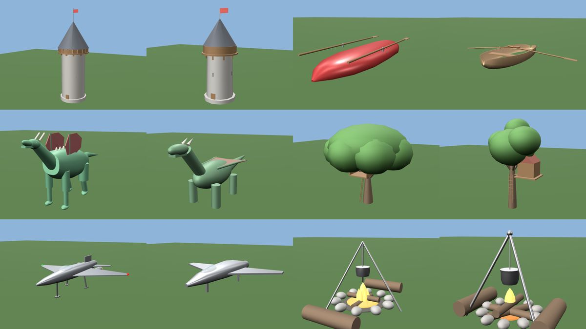

# Making 3D models with small, cheap models

Can a small model (Haiku, Flash and the like) build good 3D models for Godot if the tool gives it enough context and
checks? Not as good as the largest models; nobody should claim that. But a tool can raise the floor a lot, because
most of what goes wrong with a small model is not a lack of talent: it is working blind and not knowing the conventions.

This page records a small test, what it showed, and what Godotwright did about it.

## The test

Six Haiku agents each got one thing to model with the Godotwright command line and at most 14 tool calls: a medieval
watchtower with a wooden gallery, a rowing boat, a fantasy dragon, an oak tree with a tree house, a one-person sci-fi
fighter and a campfire with a tripod and seats. They kept a log of every error and every point of confusion. Afterwards
the models were rendered and looked at by a person.

This is six runs of one model on one tool version: an indication, not a benchmark. No larger model was run for comparison.

## What came out

- **The models were better than expected.** All six built and linted at 100/100, mostly in one or two attempts. The
  watchtower, tree house and campfire read clearly; the boat and the fighter are recognisable; the dragon is crude
  (a long-necked four-legged creature with wings) but readable. Having ready-made shapes (loft, lathe, mirror, repeat) and
  a clear spec format does a lot of the work.
- **But every agent worked blind.** None could see its model, so "100/100" only meant "valid", not "looks right". Two
  agents said so in these words.
- **The lint score gave false confidence.** A ladder that floated half a metre away from the trunk, stones that sank into the
  ground and a boat that passed an archetype check for a barn all scored 100/100.
- **The archetype check was silent about what it compared.** `--archetype watchtower` quietly became "tower",
  `--archetype campfire` and `dragon` quietly became the general rules, and a part group named `LandingGear` counted as one
  part while `TailWingLeft` counted as a second `WingLeft`. Nothing said which parts were counted.
- **Missing categories.** The library had no fortification, creature or spacecraft, so these were built from nothing.
- **Documentation gaps.** Which axis a loft width runs along, what `cy` means, the anchor names, the default segment
  counts and the list of materials were hard to find or missing.

## What Godotwright does about it

1. **`model view`** (and the MCP tool `godot_model_view`): the model as text. Three views (front, side, top) drawn with one
   letter per part, a table of the parts with sizes and heights, and the list of parts that do not touch the rest. A model
   that cannot see pictures can now check shape, proportions and attachment.
2. **`model/floating-part`** in `model lint`: a part that does not touch the rest of the model is reported (a warning in the
   air, an info on the ground). It immediately found real gaps in four of the ready-made recipes (wheels without axles on the
   truck and tractor, a motorcycle engine not joined to its frame, pylon crossarms), which are fixed, and a test now keeps
   every ready-made kind in one piece.

3. **`model brief <what>`** (and the MCP tool `godot_model_brief`): one page that hands a small model the context a large one
   would carry in its head. What the thing is, the ready-made kind to start from (and how to print its spec to edit with
   `model recipes <kind>`), the parts to name its nodes after, a typical size with its source, the rules and usual mistakes
   of that thing (the rules every model shares are said once), the order of tools to call, and a short spec cheat sheet
   (`model spec --short`). When nothing is near, it says so instead of offering unrelated kinds.

4. **An honest report in `lint --archetype`.** The report now starts with what the check really compared: how many required
   parts were found, which nodes matched no part, and whether the size was checked. When the thing is a guess, or nothing
   matched, it says that only the general rules ran and that a high score then says the file is clean, not that it is the
   right thing. The test showed small models taking 100/100 as proof; this takes that away.
5. **More things it knows.** Archetypes for fortifications (castle, wall, fort), creatures (quadruped, humanoid, dragon),
   spacecraft (rocket, spaceship, satellite), a rowing boat and a campfire, so these get parts, sizes and rules instead of a
   guess. Made-up sizes (a dragon, a spaceship) are marked class X: a wide range that only catches unit mistakes.

More is planned: recipes that can be placed inside a spec, and a second run of the same six tasks to measure the difference. See the roadmap.

## The second run

After those changes, the same six tasks were run again: six Haiku agents, the same words, the same limit of 14 tool calls,
the same command list plus the new commands (`model brief`, `model view`, `model recipes <kind>`). The tool did not change
during the run. Both sets of models were then linted with the same, current tool and rendered with the same viewer.

What was measured:

| | First run | Second run |
|---|---|---|
| Lint score (current tool) | 100, 100, 100, 100, 100, 99 | 100, 98, 100, 100, 100, 100 |
| Parts that do not touch the rest | 2 (campfire) | 0 |
| Tool calls used (of 14) | not recorded | 9, 11, 9, 5, 7, 6 |
| A ready-made kind offered by `model brief` | none existed for these things | 5 of 6 (all but the watchtower); 3 started from it (rowing boat, dragon, spaceship) |

What a person sees in the renders:

- **Better:** the rowing boat is now an open hull with thwarts (the first was a closed red shell); the tree house and the
  ladder now hang visibly on the tree; the campfire has no loose parts.
- **The same:** the watchtower and the spaceship.
- **Not better:** the dragon. The first agent built spikes and upright folded wings itself; the second started from the
  ready-made dragon and only folded its wings flat. A recipe can also narrow what an agent tries.

Problems the agents reported, and what happened to them:

- `watchtower` was still matched to the high-rise `building.tower` (30 to 830 m tall). There is now a `building.watchtower`
  archetype (`watchtower`, `wachttoren`, `uitkijktoren`, ...) with a shaft, roof, gallery, door and battlements.
- `spaceship fighter` and `sci-fi fighter` went to the fighter jet. They now mean the spaceship.
- `model view` drew each view at its own scale. All views now share one scale, said once at the top.
- Still open: the connection check compares bounding boxes, so a part a few centimetres from a round trunk counts as
  touching; the flipped-faces finding does not say where the triangles are; an oar that pivots in the middle of its length
  trips the hinge rule; the dragon has no wing-fold parameter; `model identify` and `model kinds` print a lot of text.

Again: six runs of one model, an indication and not a benchmark.

## What this does not claim

A text view is a crutch, not eyesight: it shows silhouettes and attachment, not beauty. A tool cannot give a small model a
large model's taste. The aim is narrower and measurable: fewer blind mistakes, faster convergence, a higher floor.
